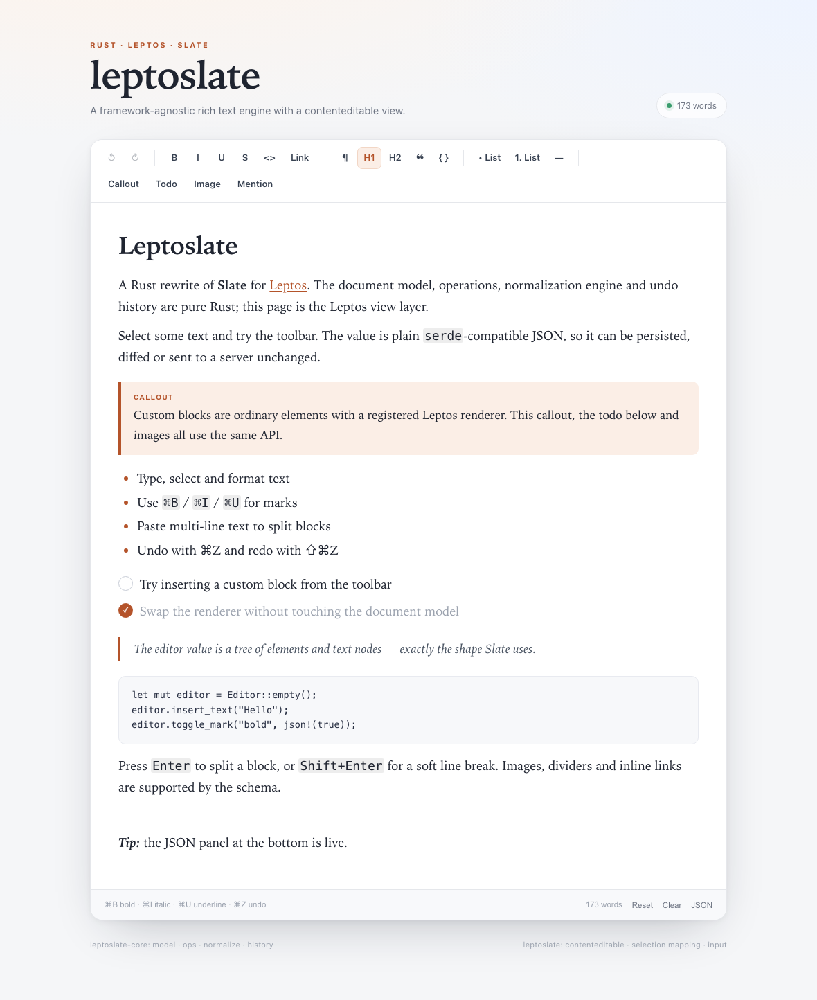

# leptoslate

A Rust rewrite of [Slate](https://docs.slatejs.org/), built for [Leptos](https://leptos.dev/).

The workspace contains a framework-agnostic document engine with the same concepts as Slate — nodes, paths, points, ranges, operations, normalization and undo history — plus a `contenteditable` view for Leptos that maps browser selections to the document model.



```
crates/
  leptoslate-core/   document model, operations, transforms, normalization, history
  leptoslate/        Leptos renderer, EditorHandle, DOM selection mapping, input handling
examples/
  demo/              Trunk-based demo application
```

## What is implemented

**Document model**

- Elements and text nodes with arbitrary JSON properties (`Props`)
- Slate-compatible JSON serialization/deserialization
- Paths, points, ranges, and the same path/point transform rules as Slate
- Character offsets (with UTF-16 conversion at the DOM boundary)
- Configurable schema for tags, inline elements, void elements and default blocks

**Editing engine**

- Operations: `insert_node`, `insert_text`, `remove_node`, `remove_text`, `merge_node`, `split_node`, `move_node`, `set_node`, `set_selection`
- Patches that are serializable and replayable
- High-level transforms:
  - insert / delete text, selection, words, blocks
  - split blocks (Enter), soft breaks (Shift+Enter), paste with block splitting
  - Enter splits the leaf block, so list items stay inside their list and paragraphs inside a blockquote stay inside the quote
  - marks (bold, italic, underline, strikethrough, inline code, colors)
  - block types, lists (wrap/unwrap), node set/unset, move
- Normalization:
  - elements always have a child
  - adjacent text nodes with equal properties merge
  - empty texts are removed when they have siblings
  - inline content wraps in the default block when needed
  - inline elements are surrounded by text
- Undo/redo with grouped transactions, inverse operations and selection restore
- Consecutive typing coalesces into one undo step until the selection moves or a non-text edit happens
- Top-level blocks are keyed by content, so typing only re-renders the changed block

**Leptos integration**

- `EditorHandle` wrapping `RwSignal<Editor>`
- Schema-driven rendering (`p`, headings, blockquotes, code, lists, tables, links, images, dividers, …)
- Structured table blocks (`table`, `thead`, `tbody`, `tfoot`, `tr`, `th`, `td`) with semantic rendering
- Table creation plus row/column authoring controls in the demo
- Pluggable element, text and mark renderers for application-specific blocks and styling
- Block/node selection for one or more top-level blocks: select, extend, delete, duplicate, copy, or type to replace a range
- Inline links: wrap a selection, edit the href, remove links, and prevent navigation while editing
- Inline void mentions: `@`-triggered picker, atoms, atom deletion, and custom renderers
- Rich fragment paste and drop: HTML by default, optional Markdown parsing, with marks, links, nested lists, structured tables and inline images
- URL safety policy for links and pasted images; unsafe schemes are rejected
- Block hover bar with select, add-below, duplicate, delete and drag-reorder actions
- Nested lists with Tab/Shift+Tab indentation and list-aware editing
- Selection bubble toolbar for marks near a text selection
- Model selection syncs from document `selectionchange`, including programmatic selections
- Undo restores single or multi-block selection, including after a group delete
- DOM selection ↔ model selection mapping via `data-text-path` attributes
- `beforeinput` handling for typing, deletion, formatting, undo/redo and IME-safe composition
- Rich copy/cut: browser-native HTML for text selections, semantic block HTML plus a hidden model payload for node selections, and plain-text fallback
- File paste/drop hook for image uploads (`FileHandler`)
- Keyboard shortcuts: ⌘/Ctrl+B, I, U, Z, Shift+Z, Y, A, D; Shift+Arrow extends block selection; Tab inserts spaces
- Accessible toolbar semantics: arrow/Home/End navigation, `aria-pressed` states, labelled floating toolbars and live block-selection announcements
- Placeholder support, active-mark/block state helpers, JSON snapshot

## Quick start

```rust
use leptos::prelude::*;
use leptoslate::{Editable, EditorHandle, Element, Node, Text};

#[component]
fn App() -> impl IntoView {
    let editor = EditorHandle::new(vec![
        Node::Element(Element::new(
            "h1",
            vec![Node::Text(Text::new("Hello"))],
        )),
        Node::Element(Element::paragraph(vec![
            Node::Text(Text::new("Start writing…")),
        ])),
    ]);

    view! {
        <button
            on:mousedown=|ev| ev.prevent_default()
            on:click={
                let editor = editor.clone();
                move |_| editor.toggle_mark("bold", serde_json::json!(true))
            }
        >
            "B"
        </button>
        <Editable editor=editor placeholder="Start writing…" />
    }
}
```

The `on:mousedown` `prevent_default()` keeps the editor selection while clicking toolbar buttons.

### Using the handle

```rust
let editor = EditorHandle::empty();

editor.insert_text("Hello");
editor.toggle_mark("italic", serde_json::json!(true));
editor.insert_break();
editor.insert_text("world");

editor.set_block("h2");
editor.toggle_list("ul");
editor.undo();
editor.redo();

println!("{}", editor.to_json_pretty());
```

`EditorHandle::update` runs the closure with `&mut Editor`, so the entire core API is available:

```rust
editor.update(|state| {
    state.insert_text("…");
    state.toggle_mark("bold", serde_json::json!(true));
    state.select_all();
});
```

### Custom blocks

Register a Leptos view for any element type:

```rust
use leptos::prelude::*;
use leptoslate::{Editable, EditorHandle, Renderers};

let renderers = Renderers::new().element("callout", |ctx| {
    let class = ctx.class_with("callout");
    let node_path = ctx.node_path;
    let children = ctx.children;
    view! {
        <aside class=class data-node-path=node_path>
            {children}
        </aside>
    }
    .into_any()
});

view! { <Editable editor=editor renderers=renderers /> }
```

`ElementRenderContext` provides the element, path, rendered children, the editor handle, and inline/void flags. A custom renderer for a void element is responsible for setting `contenteditable="false"`. Use `editor.is_node_selected(&path)` inside a reactive class to show selected chrome.

Custom blocks are ordinary elements in the document, so they serialize, normalize and undo like everything else. The demo uses renderers for a callout, a todo block, and images with alignment/delete controls.

### Custom text and mark rendering

Override how every text node is rendered, or replace the CSS emitted for individual marks:

```rust
let renderers = Renderers::new()
    .text(|ctx| {
        let class = ctx.class;
        let text_path = ctx.text_path;
        let style = ctx.style;
        view! {
            <span class=class data-text-path=text_path style=style>
                {ctx.text.text}
            </span>
        }
        .into_any()
    })
    .mark_style("code", |_| {
        "font-family:ui-monospace;background:#fdeee5;color:#8a3b16".into()
    })
    .mark_style("highlight", |value| {
        format!("background:{}", value.as_str().unwrap_or("yellow"))
    });
```

`TextRenderContext` includes the text, its marks, path, `data-text-path` value, default class and default mark CSS. The library wraps custom text views in a `data-text-path` span automatically; keep the original text contiguous inside the custom view so DOM offsets continue to map to document offsets. A mark style callback may return an empty string to suppress a built-in style.

Insert custom blocks with the core API:

```rust
use leptoslate::{Element, Node};

editor.update(|state| {
    state.insert_block_after_selection(Node::Element(
        Element::new("callout", vec![Node::empty_text()])
            .with_property("tone", serde_json::json!("info")),
    ));
});
```

Void blocks (images, dividers) automatically get a paragraph after them so typing can continue. `remove_block_at` and `set_node_properties` are available for custom block toolbars.

### Lists

`Tab` indents the current list item under its previous sibling; `Shift+Tab` outdents it. The same operations are available in core:

```rust
editor.indent_list();
editor.outdent_list();
```

Nested lists are represented as a list inside an `<li>`, with the item's inline content wrapped in a paragraph by normalization. Backspace at the start of the first item lifts it out before the list, at a later item it merges into the previous item, and Enter splits the list item while preserving its nested children.

### Block reordering

The hover-bar drag handle reorders top-level blocks. The core operation is also available directly:

```rust
editor.move_block(0, 2); // final index after removal
```

### Selection bubble

Enable a floating mark bar for non-collapsed selections:

```rust
view! { <Editable editor=editor selection_bubble=true /> }
```

The bubble offers bold, italic, underline, strikethrough and inline code, keeps the selection when clicked, shows active states, and hides for collapsed selections, node selections or when the editor loses focus. The editor is displayed in the demo with `hover_bar=true` and `selection_bubble=true`.

### Block hover bar

Enable a floating bar next to the hovered block:

```rust
view! { <Editable editor=editor hover_bar=true /> }
```

The bar provides select, add-below, duplicate, delete and drag-reorder actions. Drag the handle to move a top-level block; a drop line shows the insertion point. With the handle focused, `ArrowUp` / `ArrowDown` also reorder blocks. The bar keeps editor focus, uses the current schema's default block type for new blocks, and hides when the mouse leaves the editor surface.

### Block selection

Use the ▣ button in the hover bar to select a top-level block. Hold Shift while clicking ▣ on another block to extend the range, or use `Shift+ArrowUp` / `Shift+ArrowDown` from the keyboard. `ArrowUp` / `ArrowDown` move or collapse the selection, `Escape` clears it, and `Backspace` / `Delete` removes every block in the range. `⌘/Ctrl+D` duplicates the range and selects the copies; copy and cut emit plain text.

Custom renderers can style every selected block with `editor.is_node_selected(path)`. Built-in blocks get the `ls-block-selected` class automatically.

```rust
let selected = editor.is_node_selected(&path);
```

### Tables

Tables are ordinary element nodes, so they serialize, normalize and undo like the rest of the document:

```rust
// table -> tbody -> tr -> td -> text
let table = Node::Element(Element::new("table", vec![
    Node::Element(Element::new("tbody", vec![
        Node::Element(Element::new("tr", vec![
            Node::Element(Element::new("td", vec![Node::empty_text()])),
        ])),
    ])),
]));
```

Cells keep inline content, including marks and links. `Enter` is inert inside a cell, `Tab` / `Shift+Tab` move between cells, and `Backspace`/`Delete` at a cell boundary do not merge or destroy the table. Block and list transforms are ignored while the caret is inside a cell.

Create a table and edit it through the handle:

```rust
editor.insert_table(3, 3, true); // rows, columns, header row
editor.insert_table_row_after();
editor.delete_table_row();
editor.insert_table_column_after();
editor.delete_table_column();
```

### Rich paste

`Editable` parses `text/html` clipboard data by default. Pasting a single paragraph merges its inline content and marks into the current block; multi-block fragments split the current top-level block and insert between the halves.

```rust
view! {
    <Editable
        editor=editor
        paste_html=true       // default
        paste_markdown=false  // opt-in
    />
}
```

The core API is available directly too:

```rust
editor.insert_html("<h2>Title</h2><p>Hello <strong>world</strong></p>");
editor.insert_markdown("# Title\n\nHello **world**");
editor.insert_fragment(parsed_nodes);
```

Supported HTML includes paragraphs, headings, nested lists, blockquotes, code blocks, links, emphasis, line breaks, structured tables, block and inline images, and rules. Tables keep their `thead`/`tbody`/`tr`/`th`/`td` structure, infer a header row from leading `<th>` rows, and preserve inline marks/links in cells; malformed tables fall back to a paragraph of their text. Dropping `text/html` or `text/plain` at a point in the editor follows the same fragment path. Markdown supports headings, paragraphs, flat lists, blockquotes, fenced code, rules and common inline marks/links.

Copying a text selection uses the browser's native rich HTML, including computed mark styles and links. Copying a node/block selection serializes the selected top-level elements, so tables, images and block structure survive a round trip. The copied HTML also carries a hidden model payload, so custom block properties survive internal copy/paste while external applications still receive normal HTML. Cut follows the same rich-copy path and then deletes through the model.

### Links

Links are inline elements with an `href` property:

```rust
editor.select_point(point);      // or select a text range
editor.set_link("https://leptos.dev"); // wraps the selection or updates the link at the caret
editor.link_at_selection();      // Some(href) when the caret is inside a link
editor.link_node_at_selection(); // Some((link_path, href)) for a link editor
editor.update_link_at_selection("/docs", "docs"); // href + text in one undo step
editor.remove_link();            // unwraps links intersecting the selection
```

`update_link_at_selection` preserves the existing children and marks when the text is unchanged. When the text changes, it replaces the link text with one text node carrying the first child text node’s marks. Empty link text is rejected. Link targets use a safety policy: relative links, fragments, `http(s)`, `mailto:` and `tel:` are accepted; `javascript:`, `data:` and other opaque schemes are rejected. Pasted unsafe links are flattened to their text and unsafe image sources are skipped. The built-in renderer prevents link navigation during editing. The demo adds a Link toolbar button with an href bar for Apply/Remove.

### Mentions and inline voids

Inline void nodes are atoms that cannot be edited internally. They still live inside text, are surrounded by text nodes by normalization, and delete as a single unit:

```rust
let node = Node::Element(
    Element::new("mention", vec![Node::empty_text()])
        .with_property("id", serde_json::json!("leptos"))
        .with_property("name", serde_json::json!("Leptos")),
);

editor.insert_inline_node(node); // splits text at the caret and selects the text after it
editor.select_after_node(&path); // used when clicking a chip
```

Register a renderer for the element type to draw the chip. The demo includes a Mention picker with recipient props (`id`, `name`), renders mentions as inline chips, and supports Backspace/Delete as atom deletion. The built-in fallback renders void inline elements as non-editable spans.

Typing `@` opens the picker through the `on_mention` hook:

```rust
use leptos::prelude::*;
use leptoslate::{Editable, MentionTrigger};

let on_mention = Callback::new(move |trigger: Option<MentionTrigger>| {
    if let Some(trigger) = trigger {
        // trigger.query is the text after @
        // trigger.range covers "@query"
        show_picker.set(true);
    } else {
        show_picker.set(false);
    }
});

view! { <Editable editor=editor on_mention=on_mention /> }
```

To accept a suggestion, replace the trigger range with an atom:

```rust
editor.replace_range_with_inline_node(trigger.range, mention_node);
```

The demo filters suggestions as you type, inserts on selection, dismisses on Escape, and closes on click-away.

### Block selection

Void blocks (images, dividers, embeds) are selected as nodes rather than text ranges:

```rust
editor.select_node(&path);                   // one block, clears any text selection
eeditor.select_node_range(&[1], &[3]);        // contiguous top-level range
eeditor.extend_node_selection_to(&path);     // Shift+click another block
eeditor.extend_node_selection(1);            // Shift+ArrowDown
editor.is_node_selected(&path);              // true for every block in the range
editor.delete_node_selection();              // Backspace/Delete
editor.move_selection_off_node(false);       // ArrowRight
```

The built-in void renderer selects on click. Custom renderers can call `editor.select_node(&ctx.path)` and use `is_node_selected` in a reactive class. Backspace/Delete removes the selected blocks, Left/Right collapses into adjacent text, and typing replaces the selection.

### Images and dropped files

Images are ordinary block elements. The demo inserts them from a URL bar, a file picker, pasted files, or drag/drop:

```rust
use leptoslate::{Editable, FileHandler};

let files = FileHandler::new(move |files| {
    for file in files {
        // read/upload the file, then:
        // editor.update(|state| state.insert_block_after_selection(image_node(url)));
    }
});

view! { <Editable editor=editor on_files=files /> }
```

`Editable` already handles plain-text paste. When a paste or drop contains files, it calls `on_files` instead, so the application owns upload policy (data URL in the demo, object storage in production). Drag-over displays a drop outline.

### Slate-compatible values

```json
[
  {
    "type": "p",
    "children": [
      { "text": "Hello " },
      { "text": "world", "bold": true }
    ]
  }
]
```

```rust
use leptoslate::Editor;

let mut editor = Editor::from_json(json)?;
editor.select_all();
editor.insert_text("replaced");
let json = editor.to_json();
```

## Running the demo

```bash
rustup target add wasm32-unknown-unknown
cargo install trunk
cd examples/demo
trunk serve
```

Then open <http://localhost:8080>.

## Tests

Rust tests:

```bash
cargo test --workspace
```

The core test suite covers serialization, typing, block splitting, merging, cross-block deletion, marks, undo/redo, normalization, lists, block conversion, node selection and Unicode offsets.

Browser tests use Playwright against the real Trunk build:

```bash
cd e2e
npm ci
npx playwright install chromium
npm test
```

The config starts `trunk build` and serves `examples/demo/dist`, so the tests exercise the same DOM, input events and WASM binary as the demo. Coverage includes typing and selection sync, Enter/Backspace, toolbar marks, undo coalescing, paste, custom blocks, image insert/select/delete/undo, image toolbar controls, built-in void blocks and IME composition reconciliation.

The demo exposes a small test hook:

```js
window.__leptoslate.json()       // Slate-shaped document JSON
window.__leptoslate.selection()  // text range + node selection
```

No GitHub Actions workflow is configured; run formatting, clippy, Rust tests, the wasm build and Playwright locally.

## How it maps to Slate

| Slate | leptoslate |
| --- | --- |
| `Node[]` | `Vec<Node>` |
| `Element` / `Text` | `Element` / `Text` with `Props` |
| `Path` | `Vec<usize>` |
| `Point` / `Range` | `Point` / `Range` |
| `Operation` | `Operation` (serde tagged) |
| `Editor.apply` | `Editor::apply_op` |
| `Transforms.*` | `Editor` methods |
| `editor.marks` | `Editor::marks` |
| `normalizeNode` | built-in normalization pass |
| DOM adapter + `Editable` | `leptoslate::Editable` |

The core has no DOM or Leptos dependency, so it can be used in tests, servers, collaborative backends or other frontend frameworks.

## Design notes

- **Character offsets.** The model counts Unicode scalar values, unlike Slate's UTF-16 offsets. `leptoslate-core::text` converts at the DOM boundary. This avoids splitting surrogate pairs inside Rust strings.
- **Transactions.** Each public transform groups operations into one undoable batch. Normalization operations are recorded too, so undo reverses the exact document state.
- **Rendering.** Top-level blocks are keyed by index and content hash, so selection-only updates leave the DOM alone and typing recreates only the changed block.
- **Input.** Editing is driven by `beforeinput`, which is prevented and translated into operations. IME composition is allowed in the DOM and reconciled on `compositionend`.

### Accessibility

The demo toolbar uses `role="toolbar"` with arrow-key, Home and End navigation. Mark, block and list buttons expose `aria-pressed`; the selection bubble mirrors mark state the same way. The block hover bar and selection bubble are labelled toolbars with visible `:focus-visible` outlines. Node-selection changes are announced through a polite live region, and the mention picker exposes listbox/option semantics.

The Playwright suite includes an accessibility-focused test for toolbar roles, pressed state, keyboard focus movement, floating-toolbar labels and the live region. Manual screen-reader testing is still recommended before treating the component as fully certified.

## Performance

Top-level blocks are rendered through a keyed list. Each key combines the block index with a content hash, so selection-only changes do not touch the DOM and a text edit recreates only the affected block. Nested content still renders with its parent block.

The browser benchmark loads 1,000 paragraphs, places the caret in the middle, types 16 characters, and counts DOM mutation records:

```bash
cd e2e
npm run test:perf   # release build of the demo
```

On the development machine used for this repository (Chromium, release WASM), the benchmark records **32 mutation records for 16 keystrokes** and completes in **about 300 ms** (~19 ms per keystroke). The test asserts fewer than 100 mutation records and under five seconds in the debug build as a regression guard; absolute latency depends on the machine.

## Limitations

This is an early implementation, not a drop-in replacement for the entire Slate ecosystem:

- Client-side rendering only; no SSR/hydration adapter yet.
- A pragmatic core schema instead of Slate's plugin model. Inline links and void mentions are supported.
- Table editing covers creation, cell navigation and row/column insertion/deletion; `colspan`/`rowspan` and Markdown tables are not implemented yet.
- Markdown paste is opt-in and intentionally small; it is not a full CommonMark implementation.
- Node selection is a contiguous range of top-level blocks; discontiguous or cross-container block selection is not implemented.
- List indentation operates on the item under the caret; multi-item indentation is not implemented.
- IME composition is reconciled per text node, not with Slate's composition-aware range model.
- URL/paste sanitization applies at the editor boundary; existing stored documents are not rewritten automatically.
- Automated ARIA and keyboard tests are in place, but there has not been a manual screen-reader certification.
- No collaborative editing, OT/CRDT, or remote operation rebasing.

## License

MIT
